# Examen Segundo Parcial: Pipeline de datos contenerizado

**Alumno:** Carapia Rocha Juan Pedro
**Matrícula:** 125055450
**Materia:** Manejo Masivo de Datos (Big Data)
**Repositorio:** https://github.com/the-jp7/Examen-segundo-parcial

## Pregunta de negocio asignada

Mi matrícula termina en **0**, por lo que me corresponde:
**Ingreso total (cantidad × precio_unitario) por categoría y mes.**
El resultado son 120 registros: 10 categorías × 12 meses de 2025.

## Descripción

Pipeline para la cadena de tiendas "DataMart", completamente en contenedores:

1. **Hadoop** (modo standalone) procesa el CSV de ventas con MapReduce (Hadoop Streaming en Python).
2. **PostgreSQL** guarda los resultados con persistencia en un volumen nombrado.
3. **API Flask** expone los resultados y permite el CRUD sobre la tabla.

CSV (volumen :ro) --> hadoop (MapReduce) --> part-00000 --> cargar_resultados.py --> PostgreSQL <-- API Flask

## Estructura del proyecto

.
├── README.md
├── .gitignore
├── .env.example
├── docker-compose.yml
├── hadoop/
│   └── Dockerfile
├── mapreduce/
│   ├── mapper.py
│   ├── reducer.py
│   └── secuencial.py
├── api/
│   ├── Dockerfile
│   ├── requirements.txt
│   └── app.py
├── scripts/
│   └── cargar_resultados.py
└── evidencias/

## Requisitos

- Docker Desktop (con Docker Compose)
- Python 3 (solo para generar el dataset)

## Cómo reproducirlo

### 1. Generar el dataset

```bash
python generar_dataset.py 125055450
```

Se crea `ventas_125055450.csv` 

### 2. Configurar variables de entorno

```bash
cp .env.example .env
```
```env
MATRICULA=125055450
DATASET_PATH=./ventas_125055450.csv

POSTGRES_USER=datamart
POSTGRES_PASSWORD=datamart_demo_123
POSTGRES_DB=datamart
DB_HOST=db
DB_PORT=5432
```

> Si `DATASET_PATH` apunta a un archivo que no existe, Docker crea una carpeta vacía en su lugar y el job falla. Verifica que la ruta sea correcta.

### 3. Levantar el ambiente

```bash
docker compose up --build -d
docker compose ps
```

Levanta tres servicios en la red `datamart-net`: `hadoop`, `db` y `api`.

### 4. Ejecutar el job de MapReduce

```bash
docker compose exec hadoop bash
```

Dentro del contenedor:

```bash
cd /mapreduce
rm -rf /data/output/resultado
time hadoop jar $HADOOP_HOME/share/hadoop/tools/lib/hadoop-streaming-*.jar \
  -input /data/input/ventas_125055450.csv \
  -output /data/output/resultado \
  -mapper "python3 mapper.py" \
  -reducer "python3 reducer.py" \
  -file /mapreduce/mapper.py \
  -file /mapreduce/reducer.py
```

La salida queda en `/data/output/resultado/part-00000` (carpeta `output/` del equipo anfitrión).

### 5. Comparar con el script secuencial

```bash
time python3 /mapreduce/secuencial.py /data/input/ventas_125055450.csv > /data/output/secuencial.txt
diff /data/output/resultado/part-00000 /data/output/secuencial.txt && echo "COINCIDEN"
```

### 6. Cargar los resultados a la base de datos

```bash
docker compose exec api python /scripts/cargar_resultados.py
```

Debe mostrar `Registros cargados: 120`. El script es idempotente (`ON CONFLICT ... DO UPDATE`), así que puede ejecutarse varias veces sin duplicar datos.

### 7. Consultar la API

```bash
curl http://localhost:5000/resultados
curl http://localhost:5000/resultados/Ropa
```

---

## Evidencias

### A1. Dockerfile de Hadoop

Imagen basada en `debian:bookworm-slim` con OpenJDK 17, Python 3 y Hadoop 3.4.1 (modo standalone). Variables definidas: `JAVA_HOME`, `HADOOP_HOME` y `PATH`.

Verificación con `hadoop version` dentro del contenedor:

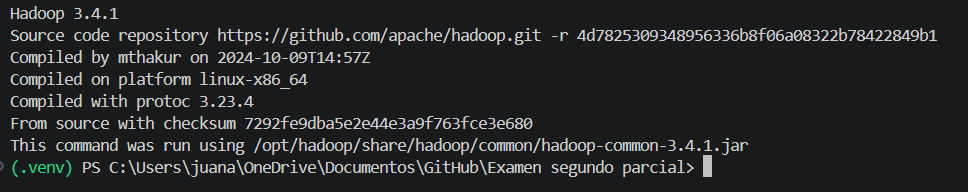

### A2. docker-compose.yml

- **hadoop**: construido con `hadoop/Dockerfile`; el dataset se monta como volumen de solo lectura en `/data/input`.
- **db**: PostgreSQL 16 con volumen nombrado `pgdata` y credenciales desde `.env`. Incluye healthcheck.
- **api**: Flask, se conecta a `db` por nombre de servicio. Usa `depends_on` hacia `db` (espera a que esté `healthy`).
- Los tres servicios comparten la red `datamart-net`.

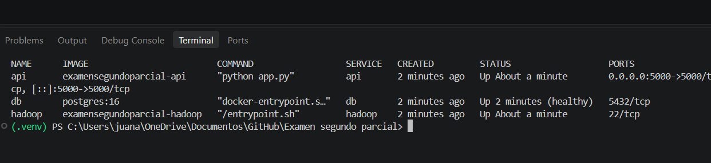

### B. SSH

- `openssh-server` instalado y corriendo en el contenedor `hadoop`.
- Usuario `hadoop` sin contraseña. Las llaves ed25519 se generan durante el build (`ssh-keygen`) y la pública se agrega a `authorized_keys`. No hay contraseñas en el Dockerfile ni en el repositorio.
- `PasswordAuthentication no`: solo se permite acceso con llave.
- La llave privada se comparte con `api` mediante el volumen `sshkeys` (solo lectura en `api`).

**`ssh localhost` dentro del contenedor hadoop:**

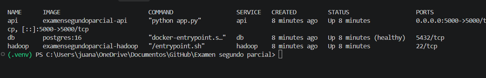

**Acceso desde el contenedor api hacia hadoop por nombre de servicio:**

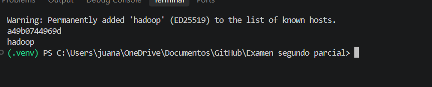

**Con contraseña no se puede entrar (`Permission denied (publickey)`):**

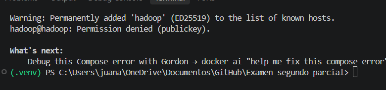

### C1. MapReduce con Hadoop Streaming

- `mapper.py`: ignora el encabezado y las líneas mal formadas (`try/except` con `continue`), calcula `cantidad × precio_unitario` y acumula localmente por clave `Categoria|YYYY-MM`. Trabaja en centavos enteros para evitar errores de punto flotante.
- `reducer.py`: suma los totales por clave y emite el ingreso en pesos con dos decimales.

Contadores clave del job: `Map input records=5000001`, `Map output records=1320`, `Reduce input groups=120`, `Reduce output records=120`, sin errores de shuffle.

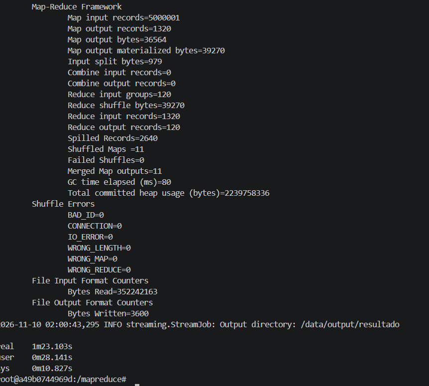

### C2. Comparativa de rendimiento

Los resultados **coinciden exactamente** (`diff` sin diferencias, 120 líneas en ambos).

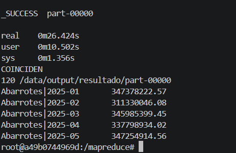

**Explicación:** el script secuencial fue más del doble de rápido porque, con un archivo de solo 400 MB y en modo standalone, Hadoop paga costos fijos que no compensa: arrancar la JVM, planear el job, lanzar los procesos de Python para el mapper y el reducer, y hacer el sort/shuffle a disco. Además, al ser standalone no hay HDFS ni paralelismo real entre nodos. El script secuencial solo recorre el archivo una vez y acumula en un diccionario en memoria. MapReduce empieza a convenir cuando los datos son mucho más grandes que lo que procesa una sola máquina (cientos de GB o TB), hay un clúster con varios nodos trabajando en paralelo y se aprovecha HDFS con localidad de datos y tolerancia a fallos.

### D. Integración

**Carga a la base de datos:**

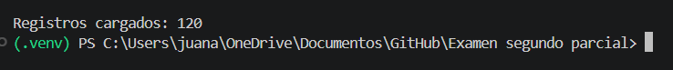

**Endpoints de la API:**

| Método | Ruta | Descripción |
|---|---|---|
| GET | `/` | Estado de la API |
| GET | `/resultados` | Todos los registros |
| GET | `/resultados/<categoria>` | Registros de una categoría (la clave de mi pregunta) |
| POST | `/resultados` | Crear un registro |
| PUT | `/resultados/<categoria>/<mes>` | Actualizar el ingreso de un registro |
| DELETE | `/resultados/<categoria>/<mes>` | Borrar un registro |

**Consultas GET:**

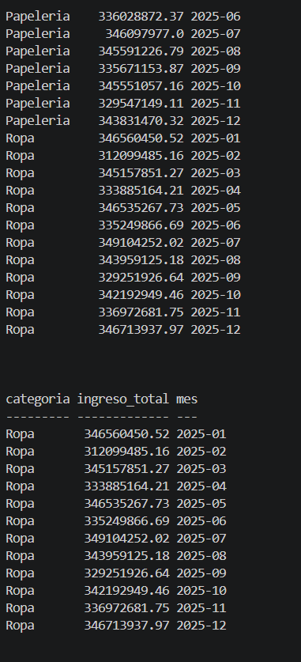

**Escritura (POST, PUT y DELETE sobre la tabla):**

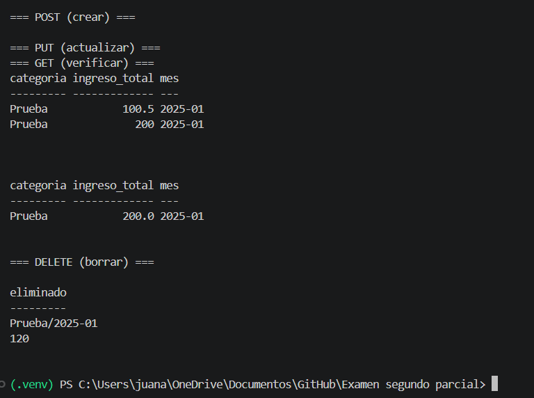

**Persistencia tras `docker compose down` y `docker compose up`:**
los datos siguen ahí sin volver a cargar, porque PostgreSQL guarda sus archivos en el volumen nombrado `pgdata`.

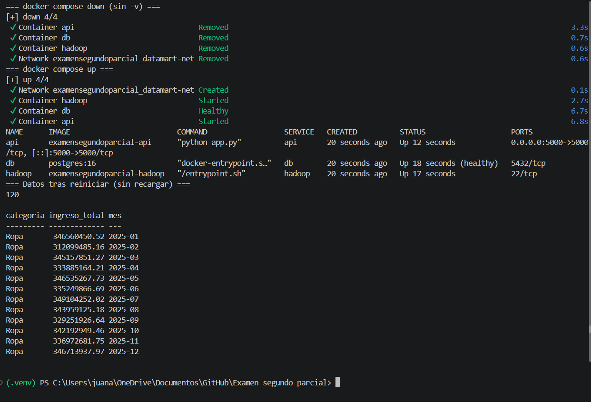


## Parte E. Teoría

### 1. Modos de Hadoop y uso de HDFS

En **standalone** todo corre en un solo proceso Java, sin demonios y usando el sistema de archivos local; sirve para pruebas y desarrollo. En **pseudo-distribuido** hay una sola máquina, pero cada demonio (NameNode, DataNode, ResourceManager, NodeManager) corre como proceso independiente y se comunican entre sí, por eso se requiere SSH a localhost. En **totalmente distribuido** los demonios se reparten entre varias máquinas de un clúster. **HDFS** se usa en pseudo-distribuido y en totalmente distribuido, no en standalone.

### 2. Volumen vs COPY para el dataset

- Una imagen con 400 MB de datos sería pesada y lenta de construir, subir y compartir.
- El dataset es distinto para cada alumno y cambia sin que el código cambie; con un volumen se cambia el CSV sin reconstruir la imagen.
- Se monta en solo lectura (`:ro`), lo que protege el archivo original.
- Se separan el código (imagen) y los datos, y se evita que el CSV termine dentro de una imagen o del repositorio.

### 3. `docker compose down` vs `docker compose down -v`

`docker compose down` elimina los contenedores y la red, pero **conserva los volúmenes nombrados**, así que los datos de PostgreSQL siguen en `pgdata`. `docker compose down -v` además **elimina los volúmenes**, por lo que se pierde la base de datos y hay que recargar los resultados con el script.

### 4. MapReduce vs script secuencial en 400 MB

Con 400 MB, MapReduce tiene costos fijos (arranque de la JVM, planeación del job, procesos de Python, sort y shuffle por disco), y en modo standalone no hay paralelismo real ni HDFS. En mi medición Hadoop tardó 1 min 8.6 s y el secuencial 28.5 s. Conviene MapReduce cuando los datos superan lo que cabe o se procesa bien en una sola máquina (cientos de GB o TB), cuando hay un clúster con varios nodos, HDFS con localidad de datos y se necesita tolerancia a fallos.

### 5. CMD vs ENTRYPOINT, y COPY vs ADD

`ENTRYPOINT` define el programa principal del contenedor, que siempre se ejecuta; `CMD` define el comando o los argumentos por defecto, y se sobrescribe fácilmente al ejecutar `docker run`. Si se usan juntos, `CMD` funciona como argumentos de `ENTRYPOINT` (en este proyecto, `hadoop` usa `ENTRYPOINT ["/entrypoint.sh"]`). `COPY` solo copia archivos o carpetas del contexto de build a la imagen; `ADD` hace lo mismo y además extrae archivos `.tar` locales y acepta URLs, por lo que se recomienda `COPY` salvo que se necesiten esas funciones.
